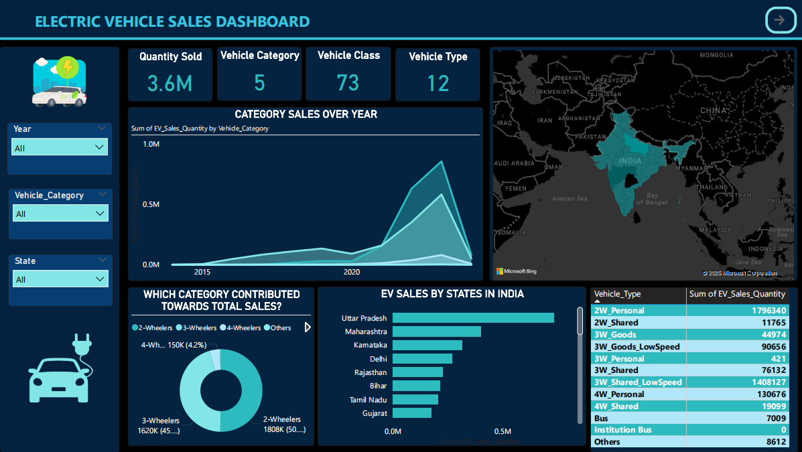
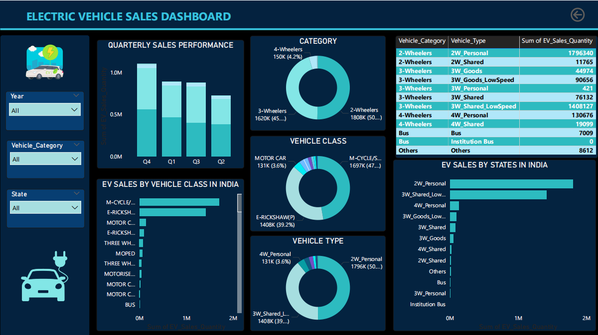
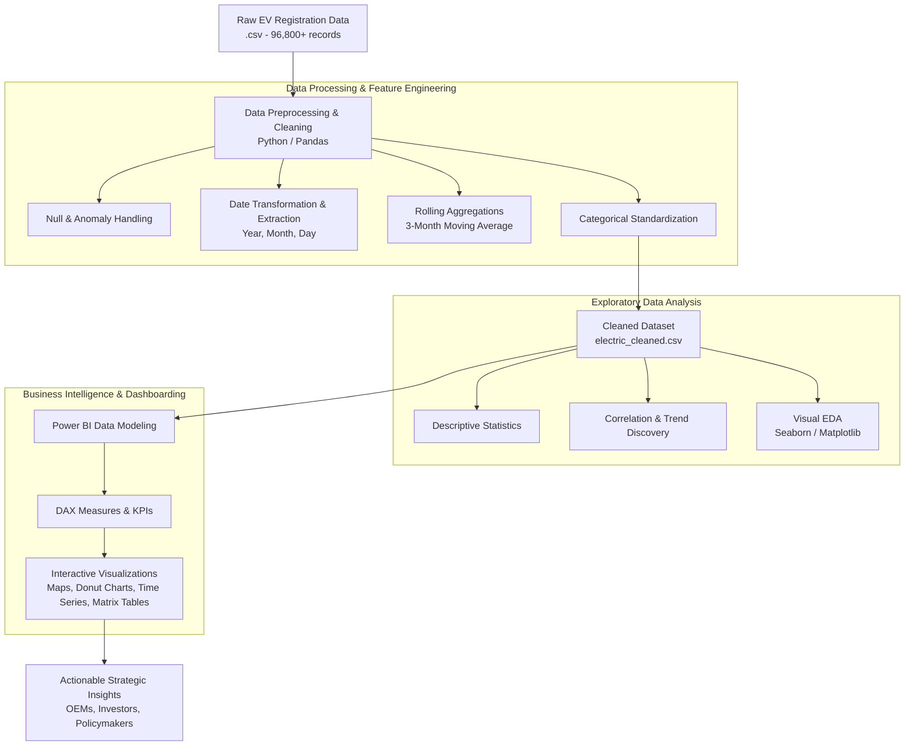

# ⚡ Electric Vehicle (EV) Sales Analysis & Business Intelligence Dashboard

<p align="center">
  
</p>

<p align="center">
  <a href="#-project-overview"></a>
  <a href="#-tech-stack--tools"></a>
  <a href="#-tech-stack--tools"></a>
  <a href="#-tech-stack--tools"></a>
  <a href="#-data-architecture--pipeline"></a>
  <a href="#-license"></a>
</p>

---

## 📌 Table of Contents
- [Executive Summary](#-executive-summary)
- [Key Performance Indicators (KPIs)](#-key-performance-indicators-kpis)
- [Interactive Dashboard Showcase](#-interactive-dashboard-showcase)
- [Data Architecture & Pipeline](#-data-architecture--pipeline)
- [In-Depth Analytical Insights](#-in-depth-analytical-insights)
  - [1. Vehicle Category & Type Distribution](#1-vehicle-category--type-distribution)
  - [2. Geographic & State-Level Penetration](#2-geographic--state-level-penetration)
  - [3. Historical Growth Trajectory & Seasonality](#3-historical-growth-trajectory--seasonality)
- [Strategic Business Recommendations](#-strategic-business-recommendations)
- [Project Directory Structure](#-project-directory-structure)
- [Data Dictionary](#-data-dictionary)
- [Getting Started & Reproduction Guide](#-getting-started--reproduction-guide)
- [Tech Stack & Tools](#-tech-stack--tools)
- [License](#-license)

---

## 🚀 Executive Summary

India's mobility sector is undergoing an unprecedented electrification revolution driven by supportive government policies (such as FAME-II, state EV policies, and PLI schemes), escalating fuel costs, and growing environmental awareness.

This project delivers an **end-to-end data analytics and business intelligence solution** analyzing **3.59+ Million Electric Vehicle (EV) registration records** spanning 2014 to 2024 across **34 Indian States & Union Territories**. Through comprehensive data preprocessing, exploratory data analysis (EDA), and interactive Power BI dashboard modeling, this project uncovers critical market dynamics, regional adoption variations, class-wise market shares, and seasonal demand trends to guide OEM strategies, charging infrastructure investments, and policy decisions.

---

## 📊 Key Performance Indicators (KPIs)

<div align="center">

| Metric | Figure | Business Context |
| :--- | :--- | :--- |
| **Total EV Units Sold** | **3.59M+ (3,593,811)** | Aggregate volume across analyzed timeframe |
| **Vehicle Categories** | **5 Categories** | 2-Wheelers, 3-Wheelers, 4-Wheelers, Buses, Others |
| **Vehicle Classes** | **73 Classes** | Granular classifications (e.g., E-Rickshaws, Scooters, Motor Cars) |
| **Vehicle Types** | **12 Specific Segments** | Distinct operational types (Personal, Shared, Goods, Low-Speed) |
| **Geographic Coverage** | **34 States & UTs** | Nationwide regional coverage across India |
| **Analysis Period** | **2014 – 2024** | Longitudinal dataset tracking market takeoff |

</div>

---

## 🖥️ Interactive Dashboard Showcase

The Power BI solution is structured into multi-dimensional views providing both strategic high-level executive summaries and granular operational drill-downs.

### 1. Executive Overview Dashboard
> **Focus:** High-level metrics, category adoption splits, geospatial concentration, state rankings, and longitudinal category trajectories.

<p align="center">
  
</p>

### 2. Deep-Dive Segment & Seasonality Dashboard
> **Focus:** Quarterly performance cycles, detailed vehicle class breakdowns, low-speed vs. high-speed segment analysis, and category-level cross-filtering.

<p align="center">
  
</p>

---

## 🏗️ Data Architecture & Pipeline

The project follows a robust, end-to-end data engineering and analytics lifecycle:



---

## 🔍 In-Depth Analytical Insights

### 1. Vehicle Category & Type Distribution

```
2-Wheelers : ████████████████████████████ 50.31% (1,808,105 units)
3-Wheelers : █████████████████████████ 45.09% (1,620,310 units)
4-Wheelers : ██ 4.17% (149,775 units)
Others     : ▏ 0.24% (8,612 units)
Buses      : ▏ 0.20% (7,009 units)
```

- **Micro-Mobility Dominance:** Combined, **2-Wheelers and 3-Wheelers account for 95.4% of total EV sales**, cementing India's status as a lightweight and shared-mobility driven EV economy.
- **2W Personal Segment:** Accounts for **49.98% (1.796M units)** of all registrations, fueled by favorable total cost of ownership (TCO) parity, home charging convenience, and competitive entry price points.
- **3W Commercial & Shared Mobility:** **3W Shared Low-Speed vehicles (E-Rickshaws)** alone account for **39.18% (1.408M units)**, acting as the primary driver of first- and last-mile urban transit electrification in Tier-2 and Tier-3 markets.
- **4W & Commercial Mass Transit Potential:** 4-Wheelers (4.17%) and Electric Buses (0.20%) currently represent an untapped frontier with immense upside potential as battery prices decline and public charging networks expand.

---

### 2. Geographic & State-Level Penetration

<div align="center">

| State / UT | Total EV Sales | Market Share (%) | Key Drivers & Characteristics |
| :--- | :---: | :---: | :--- |
| **Uttar Pradesh** | **732,074** | **20.37%** | Massive E-Rickshaw (3W) adoption across Tier-2/3 cities |
| **Maharashtra** | **401,535** | **11.17%** | High 2W and 4W adoption; robust charging infrastructure |
| **Karnataka** | **315,498** | **8.78%** | Tech hub adoption; aggressive state EV policies & incentives |
| **Delhi (NCT)** | **268,538** | **7.47%** | Pioneer in EV policy subsidies, high urban density, strict emissions targets |
| **Rajasthan** | **228,573** | **6.36%** | Fast-growing 2W adoption in tier-1/2 urban clusters |
| **Bihar** | **213,465** | **5.94%** | Heavy shared 3W/E-Rickshaw transit base |
| **Tamil Nadu** | **206,902** | **5.76%** | Major EV manufacturing hub with high personal 2W uptake |
| **Gujarat** | **176,713** | **4.92%** | Industrial corridor adoption and robust power grid infrastructure |
| **Assam** | **151,917** | **4.23%** | North-East leader in last-mile E-Rickshaw connectivity |
| **Kerala** | **133,246** | **3.71%** | High consumer awareness, premium 2W/4W adoption |

</div>

> **Geographic Concentration:** The top 5 states collectively account for **over 54.1%** of India's total EV registrations.

---

### 3. Historical Growth Trajectory & Seasonality

- **Exponential Inflection (2021–2023):**
  - **2014–2020:** Steady early-stage baseline growth (from 2.4K units in 2014 to 124.6K units in 2020).
  - **2021:** Market surged to **331,498 units** (+165.8% YoY).
  - **2022:** Reached unicorn milestone of **1,024,723 units** (+209.1% YoY).
  - **2023:** All-time peak of **1,525,179 units** (+48.8% YoY).
- **Quarterly Seasonality:**
  - **Q4 (October – December)** consistently emerges as the highest volume quarter, driven by festive shopping seasons (Diwali, Dussehra), year-end corporate fleet purchasing, and fiscal subsidy deadlines.
  - **Q1 (January – March)** sustains momentum with financial year-end tax depreciation and budget allocations.
  - **Q2 (April – June)** experiences regular seasonal cooling.

---

## 💡 Strategic Business Recommendations

### 🏎️ For EV Original Equipment Manufacturers (OEMs)
- **Scale 2W Platform Offerings:** Capitalize on the 50%+ market volume with high-efficiency 2W commuter platforms tailored for sub-$1,200 price brackets.
- **Accelerate Commercial Cargo 3W & LCVs:** Target the fast-growing 3W Goods & Logistics fleet transition for quick commerce and e-commerce delivery hubs.
- **Design Affordable 4W Commuters:** Bridge the gap between high-end EVs and budget ICE vehicles to unlock the private 4W adoption wave.

### ⚡ For Charging Infrastructure Operators (CPOs)
- **Target Top 5 Urban Hubs:** Prioritize fast-charging corridors across Maharashtra, Karnataka, Delhi-NCR, Tamil Nadu, and Gujarat.
- **Battery Swapping for 2W/3W:** Establish dense swapping station networks near urban commercial corridors, transit hubs, and logistics warehouses.

### 🏛️ For Policymakers & Urban Planners
- **Incentivize Heavy EV Segments:** Expand fiscal subsidies and zero-emission mandates for public buses and institutional fleets to combat urban smog.
- **Tier-2/3 Grid Readiness:** Upgrade local distribution transformers and provide dedicated EV charging feeder lines in high-uptake states like UP, Bihar, and Rajasthan.

---

## 📂 Project Directory Structure

```text
Electric-Vehicle-Sales-Analysis/
├── assets/                                 # Visual assets & dashboard captures
│   ├── dashboard_overview.png              # Executive KPI & overview screen
│   └── dashboard_detailed.png              # Segment & quarterly analysis screen
├── dashboard/                              # Power BI solution files
│   ├── Dashboard.pbix                      # Interactive Power BI report source
│   └── Dashboard.pdf                       # High-resolution PDF export of report
├── data/                                   # Data directory
│   ├── raw/                                # Raw immutable source dataset
│   │   └── Electric Vehicle Sales by State in India.csv
│   └── processed/                          # Cleaned, standardized & engineered data
│       └── electric_cleaned.csv
├── notebooks/                              # Jupyter analysis workflows
│   └── electric_vehicle_sales_analysis.ipynb # End-to-end data preparation & EDA
├── requirements.txt                        # Python dependencies
└── README.md                               # Project documentation
```

---

## 📖 Data Dictionary

### Cleaned Dataset Schema (`data/processed/electric_cleaned.csv`)

| Column Name | Data Type | Description | Example Values |
| :--- | :--- | :--- | :--- |
| `Year` | `Integer` | Registration year | `2015`, `2022`, `2023` |
| `Month_Name` | `String` | Month of vehicle registration | `January`, `October` |
| `Date` | `Date` | Formatted calendar date | `2022-04-01` |
| `State` | `String` | State or Union Territory | `Maharashtra`, `Uttar Pradesh` |
| `Vehicle_Class` | `String` | Specific vehicle registration category | `M-CYCLE/SCOOTER`, `E-RICKSHAW(P)` |
| `Vehicle_Category` | `String` | Broad vehicle classification | `2-Wheelers`, `3-Wheelers`, `4-Wheelers`, `Bus` |
| `Vehicle_Type` | `String` | Granular operational use-case | `2W_Personal`, `3W_Shared_LowSpeed`, `4W_Personal` |
| `EV_Sales_Quantity`| `Integer` | Number of electric vehicle units registered | `124`, `5200` |
| `Month` | `Integer` | Extracted numerical month (1–12) | `1`, `10` |
| `Day` | `Integer` | Extracted calendar day | `1`, `15` |
| `Sales_Rolling_3` | `Float` | 3-Month rolling average sales figure | `1423.67` |

---

## 🛠️ Getting Started & Reproduction Guide

### Prerequisites
- **Python 3.8+**
- **Microsoft Power BI Desktop** (Optional, to interact with `.pbix`)

### 1. Clone & Set Up Environment
```bash
# Clone the repository
git clone https://github.com/your-username/Electric-Vehicle-Sales-Analysis.git
cd Electric-Vehicle-Sales-Analysis

# Create and activate virtual environment
python -m venv venv
# On Windows:
venv\Scripts\activate
# On macOS/Linux:
source venv/bin/activate

# Install required libraries
pip install -r requirements.txt
```

### 2. Run the Analytics Notebook
```bash
jupyter notebook notebooks/electric_vehicle_sales_analysis.ipynb
```

### 3. Open the Power BI Dashboard
1. Open **Microsoft Power BI Desktop**.
2. Navigate to `dashboard/Dashboard.pbix` and open the file.
3. Use interactive slicers (Year, State, Vehicle Category) to dynamically analyze slices of data.
4. If Power BI is not installed, view the pre-rendered full report at `dashboard/Dashboard.pdf`.

---

## 🧰 Tech Stack & Tools

- **Data Processing & Analytics:** Python (`pandas`, `numpy`)
- **Exploratory Visualizations:** Matplotlib, Seaborn
- **Interactive BI & Dashboarding:** Microsoft Power BI (DAX, Power Query, Data Modeling)
- **Environment & Execution:** Jupyter Notebook, Python Virtualenv
- **Version Control & Documentation:** Git, Markdown, Mermaid.js

---

## 📜 License

This project is licensed under the **MIT License** - see the [LICENSE](LICENSE) file for details.

---

<p align="center">
  <b>⭐ If you find this analysis insightful, please consider starring this repository! ⭐</b>
</p>
